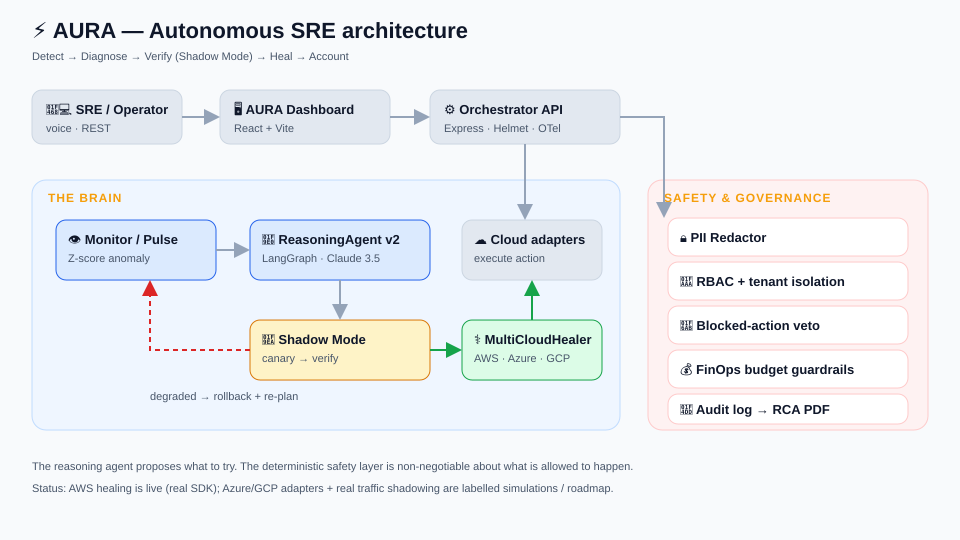

<h1 align="center">
  <br/>
  ⚡ <strong>AURA</strong>
  <br/>
  <sub>Autonomous SRE — reliability without humans, safety without compromise</sub>
</h1>

<p align="center">
  <em>AURA detects, diagnoses, and heals cloud incidents in real time — and proves every AI fix in a sandbox <strong>before</strong> it ever touches production.</em>
</p>

<p align="center">
  
  
  
</p>

<p align="center">
  <a href="#the-problem">Problem</a> •
  <a href="#the-product">Product</a> •
  <a href="#shadow-mode-our-wedge">Shadow Mode</a> •
  <a href="#how-it-works">How it works</a> •
  <a href="#the-win">The win</a> •
  <a href="#documentation">Docs</a> •
  <a href="#the-team">Team</a>
</p>

<p align="center">
  <sub>
    📄 <a href="docs/VISION.md">Vision</a> ·
    🏗 <a href="docs/architecture/ARCHITECTURE.md">Architecture</a> ·
    📊 <a href="docs/MARKET.md">Market</a> ·
    🗺 <a href="docs/ROADMAP.md">Roadmap</a> ·
    🔒 <a href="docs/SECURITY.md">Security</a> ·
    🎬 <a href="docs/DEMO.md">Demo script</a> ·
    ❓ <a href="docs/FAQ.md">FAQ</a>
  </sub>
</p>

---

## The problem

Every cloud team lives with the same 3 AM reality: an alert fires, a human gets paged, and the clock
starts on an outage that costs real money every minute it runs. The industry has two options today,
and both are bad:

- **Humans** are accurate but slow, expensive, and burn out.
- **Autonomous AI agents** are fast but **nobody trusts them to touch production** — one wrong
  `terminate-instances` and you've turned an incident into a catastrophe.

That trust gap is why most "AI SRE" tools stop at *recommending* a fix and leave a human to click
the button. The autonomy is theatre.

## The product

**AURA is an autonomous SRE teammate** built around a single conviction: **an agent earns the right
to act by proving its fix is safe first.** It runs a closed incident loop —

> **Detect → Diagnose → Verify in a sandbox → Heal → Account**

— across AWS, Azure, and GCP, with safety, cost, and compliance baked into the pipeline rather than
bolted on. The result is autonomy a platform team can actually switch on.

## Shadow Mode — our wedge

The entire category is blocked on one question: *can I trust the agent to act?* **Shadow Mode is our
answer.** Before any change reaches production, AURA rehearses the remediation in an isolated canary,
watches its health (latency, error rate), and **promotes only a fix that stays healthy** — otherwise
it rolls back and re-plans.

```
AI proposes fix ──▶ 🧪 SHADOW CANARY (isolated, 5% traffic)
                         │
           health 100% ──┴── health degraded
                 │                   │
           promote to prod      roll back + re-plan
```

Everyone else recommends. **AURA acts — safely.**

## How it works

AURA is an event-driven, multi-agent system. A reasoning agent (Amazon Bedrock / Claude 3.5 Sonnet,
orchestrated with LangGraph) proposes *what to try*; an independent safety layer — PII redaction,
role-based access control, blocked-action governance, FinOps budget locks, and Shadow Mode —
constrains *what is allowed to happen*. The intelligence proposes; the deterministic guardrails
dispose.



➡️ Full detail in **[docs/architecture/ARCHITECTURE.md](docs/architecture/ARCHITECTURE.md)**.

## The win

AURA was selected as a **Winner** at the
**[AWS Global Vibe: AI Coding Hackathon 2025](https://aws.amazon.com/startups/events/aws-global-vibe-ai-coding-hackathon-2025)**
(DoraHacks · $700K+ prize pool · 920 hackers · 106 builds), across three prize categories:

| Award | Value |
|---|---|
| 🥇 AWS Startup Activate Credits (main-track Winners) | $10,000 |
| 🥇 Arcanum.ai Expert Guidance / Tooling — productionisation program | $10,000 |
| 🥇 Lovable Annual Pro Subscription | $3,000 |

Proof and the full story: **[docs/proof/README.md](docs/proof/README.md)**.


## Documentation

| Doc | What's in it |
|---|---|
| [**Vision**](docs/VISION.md) | Why AURA exists, the thesis, the long game |
| [**Architecture**](docs/architecture/ARCHITECTURE.md) | System design, agents, safety layer, data flow |
| [**Shadow Mode**](docs/architecture/SHADOW_MODE.md) | The deep dive on our core innovation |
| [**Market**](docs/MARKET.md) | TAM, competitors, our differentiation |
| [**Roadmap**](docs/ROADMAP.md) | Prototype → product → platform |
| [**Security & Trust**](docs/SECURITY.md) | How we earn the right to act autonomously |
| [**Demo script**](docs/DEMO.md) | Run the detect→heal loop in 90 seconds |
| [**FAQ**](docs/FAQ.md) | The hard questions, answered honestly |
| [**Proof**](docs/proof/README.md) | Hackathon win evidence |

## Honest status

AURA is an **early-stage prototype with a validated thesis**, not a shipped enterprise product. The
AWS healing path and FinOps scan call real AWS SDKs; the Azure/GCP adapters and some demo signals are
simulations, clearly labelled as such. We publish our boundaries on purpose — see the
[FAQ](docs/FAQ.md) and [Roadmap](docs/ROADMAP.md). The core engine source lives in a separate private
repository; this repository is AURA's public documentation and brand home.

## The team

AURA was built by a small team for the AWS Global Vibe: AI Coding Hackathon 2025 and is being carried
forward through the Arcanum.ai productionisation program. Reach out via the links in
[docs/CONTACT.md](docs/CONTACT.md).

---

<p align="center">
  <strong>⚡ AURA — the agent proposes the fix; Shadow Mode proves it's safe before production ever sees it.</strong>
</p>

<p align="center">
  <sub>© 2025–2026 AURA. Documentation licensed under <a href="LICENSE">CC BY 4.0</a>. Winner — AWS Global Vibe: AI Coding Hackathon 2025.</sub>
</p>
