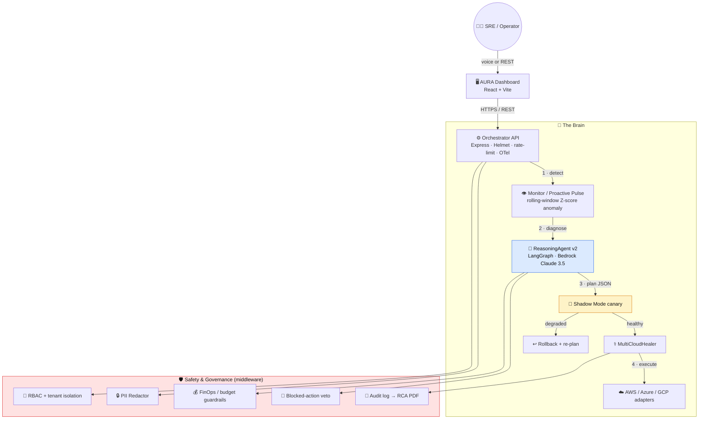

# Architecture

AURA is an **event-driven, multi-agent system**. An Express orchestrator is the spine; each
capability is a focused agent with one job; and the safety concerns (PII, RBAC, cost, audit, Shadow
Mode) are cross-cutting layers rather than afterthoughts.

> **One-line design principle:** the reasoning agent is free to be creative about *what to try*; the
> deterministic safety layer is non-negotiable about *what is allowed to happen*.

## System overview

## The incident loop

| Phase | What happens | Component |
|---|---|---|
| **1 · Detect** | A CloudWatch alarm, a chaos injection, or AURA's own 30s proactive pulse flags an anomaly. A rolling-window **Z-score** detector separates real drift from noise. | Monitor / Proactive Pulse |
| **2 · Diagnose** | A LangGraph `diagnose → plan → validate` graph analyses the telemetry and emits a **structured JSON** remediation plan (action, target, confidence). | ReasoningAgent v2 (Bedrock / Claude 3.5) |
| **3 · Verify** | The fix is rehearsed in an isolated **Shadow Mode** canary; health is checked before anything real changes. | Shadow engine |
| **4 · Heal** | On a healthy canary, the approved action (restart / scale / reroute) executes through a cloud-specific adapter. | MultiCloudHealer |
| **5 · Account** | Every step is PII-scrubbed, RBAC-gated, cost-checked, and written to an audit log exportable as a signed RCA PDF. | Safety & Governance layer |

## The agents

- **ReasoningAgent v2** — a LangGraph state machine (`diagnose → plan → validate`). Primary brain is
  Amazon Bedrock / Claude 3.5 Sonnet (via an OpenAI-compatible interface). If no model or key is
  reachable, a deterministic `SimulatedBrain` returns a valid plan so the system **degrades
  gracefully and never hard-fails** a demo.
- **MultiCloudHealer** — an Abstract-Factory of `CloudAdapter`s. The **AWS adapter calls real Lambda
  APIs** (with a simulation fallback when credentials are absent); the **Azure and GCP adapters are
  explicitly labelled simulations**. New providers drop in behind the same interface.
- **FinOpsAgent** — scans EC2 for idle resources via CloudWatch and can stop them; a budget-lock
  policy fires when projected waste crosses a threshold.
- **BaseAgent** — the abstract `monitor / analyze / heal / approve / report` contract every provider
  agent implements.

## The safety & governance layer

This is the part that makes autonomy sellable. It is deterministic and runs regardless of what the
model says:

- **PII Redactor** — regex-scrubs emails, IPv4 addresses, and AWS access keys from anything before it
  is logged *or* sent to the LLM. The model never sees a secret.
- **RBAC + multi-tenancy** — a `viewer / operator / admin / system_agent` permission matrix; every
  protected route requires an `X-Tenant-ID`; rate limiting is per-tenant.
- **Blocked-action governance** — a hard veto list (`DeleteDBInstance`, `TerminateInstances`,
  `DeleteBucket`) the AI path can never execute, no matter how confident the plan.
- **FinOps budget guardrails** — cost-aware remediation; a spending freeze engages before an
  expensive auto-scale.
- **Audit → RCA PDF** — an append-only event bus feeds a `pdf-lib` generator that produces a
  per-incident root-cause report for compliance.

## Observability

- **OpenTelemetry** auto-instrumentation across the AWS SDK and Express.
- **Prometheus** (`prom-client`) `/metrics` endpoint — an incident counter (by severity + tenant) and
  a healing-duration histogram.
- Structured JSON logs with per-request IDs and injected system context (peak-hours, maintenance
  window, threat level).

## Infrastructure as code

An AWS CDK (TypeScript) stack provisions the demo target surface: a sample Lambda with an injectable
failure (the chaos target), an SNS alert topic, a CloudWatch error alarm wired to it, and an API
Gateway `/simulate` route.

## Tech stack

| Layer | Technology |
|---|---|
| AI brain | Amazon Bedrock · Claude 3.5 Sonnet · LangGraph (OpenAI-compatible fallback + simulated brain) |
| Dev acceleration | Amazon Q Developer |
| Backend | Node.js 20 · Express · Helmet · express-rate-limit · Zod |
| Agents | `@langchain/langgraph` · `@langchain/aws` · `@langchain/core` |
| Cloud SDKs | `@aws-sdk` Bedrock-Runtime · Lambda · EC2 · CloudWatch · SNS |
| Observability | OpenTelemetry · prom-client · Winston |
| Reports | pdf-lib |
| Frontend | React 18 · Vite |
| IaC | AWS CDK (TypeScript) → Lambda · API Gateway · SNS · CloudWatch |
| Deploy | Render (backend) · Netlify / Vercel (frontend) |

## Design decisions worth calling out

**Why multi-agent instead of one monolith agent?** Separation of concerns and blast-radius control.
The reasoning agent can be swapped or upgraded without touching the healer; the safety layer applies
uniformly no matter which agent proposed the action.

**Why a hard safety layer instead of trusting a well-prompted model?** Prompts are probabilistic;
guardrails are not. A regex redactor, an RBAC check, and a blocked-action list behave identically on
the model's best and worst day. That determinism is exactly what an enterprise buyer is paying for.

**Why Shadow Mode instead of direct apply with rollback?** Rollback is damage control *after* prod is
already affected. Shadow Mode moves the proof *before* the blast radius — see
[SHADOW_MODE.md](SHADOW_MODE.md).
