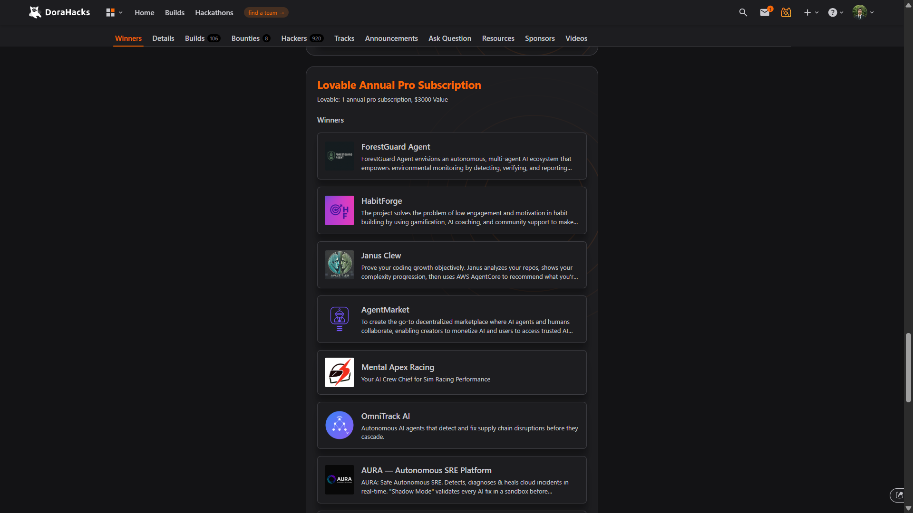
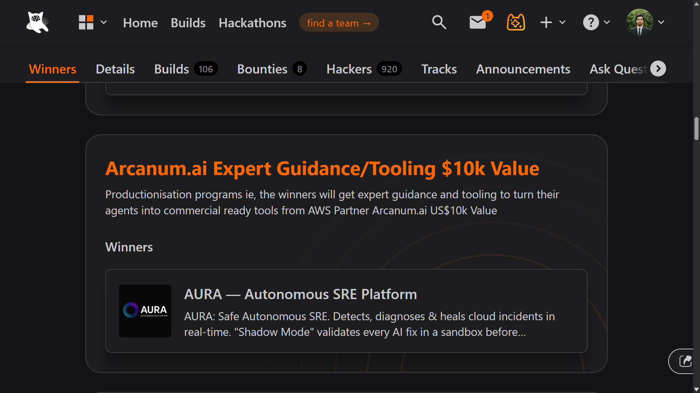
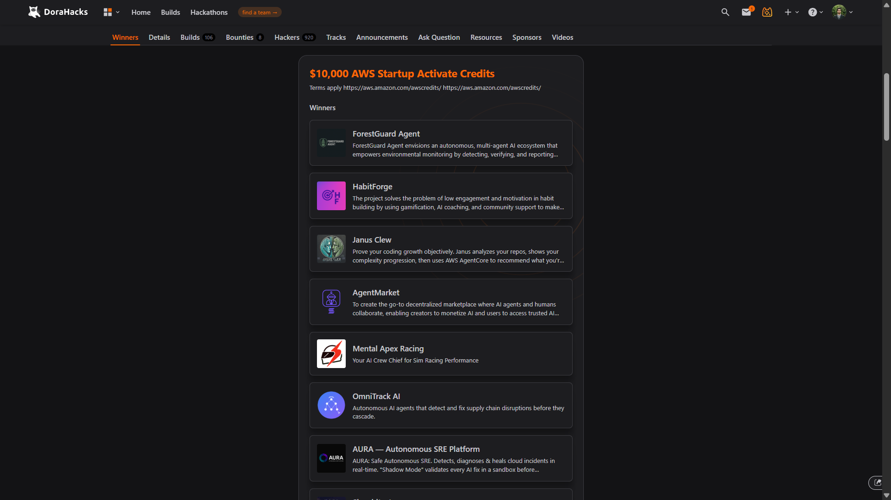
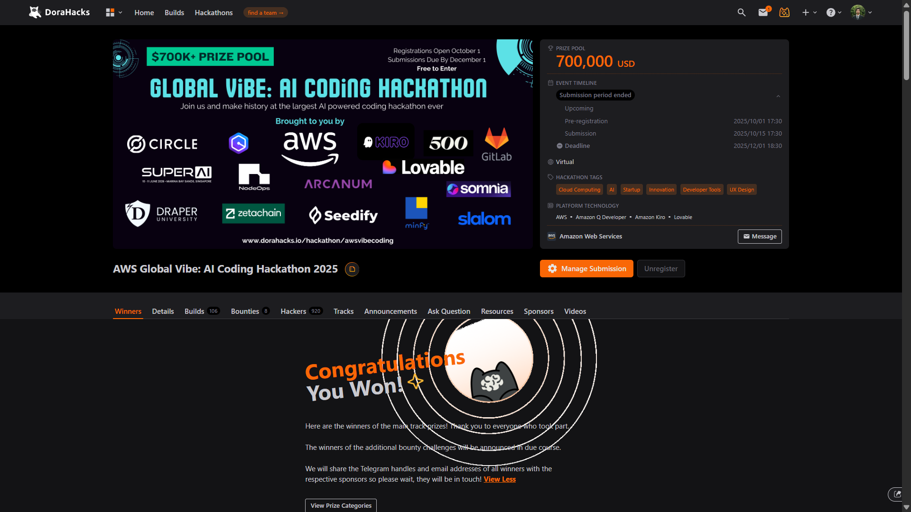
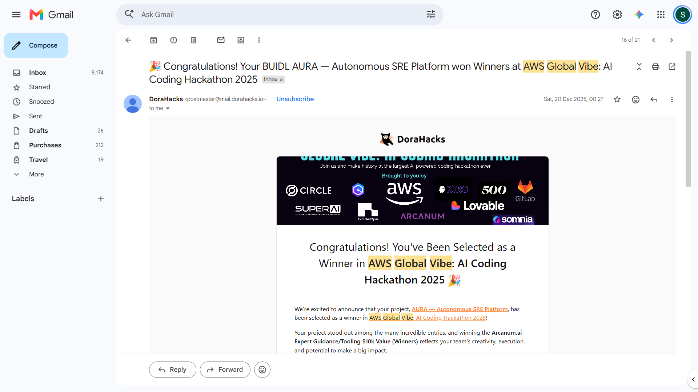

# Proof — AWS Global Vibe: AI Coding Hackathon 2025

**AURA — Autonomous SRE Platform** was selected as a **Winner** at the
[AWS Global Vibe: AI Coding Hackathon 2025](https://aws.amazon.com/startups/events/aws-global-vibe-ai-coding-hackathon-2025),
hosted on DoraHacks — a **$700K+ prize pool**, **920 hackers**, **106 builds**.

## What AURA won

| Award | Value |
|---|---|
| 🥇 AWS Startup Activate Credits (main-track Winners) | $10,000 |
| 🥇 Arcanum.ai Expert Guidance / Tooling — productionisation program | $10,000 |
| 🥇 Lovable Annual Pro Subscription | $3,000 |

> *"Congratulations! Your BUIDL — AURA — Autonomous SRE Platform won Winners at AWS Global Vibe: AI
> Coding Hackathon 2025."* — DoraHacks winner notification

**Platform technology (per the event listing):** AWS · Amazon Q Developer · Amazon Kiro · Lovable.

## Evidence

### The hackathon & prize pool

### Winners — AWS Startup Activate Credits

### Winners — Arcanum.ai productionisation program

### Winners — Lovable Pro

### Winner notification email

